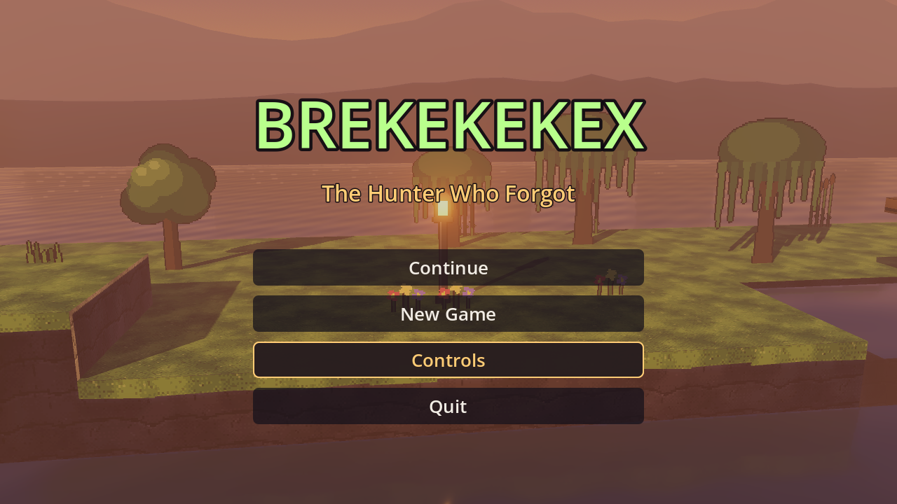
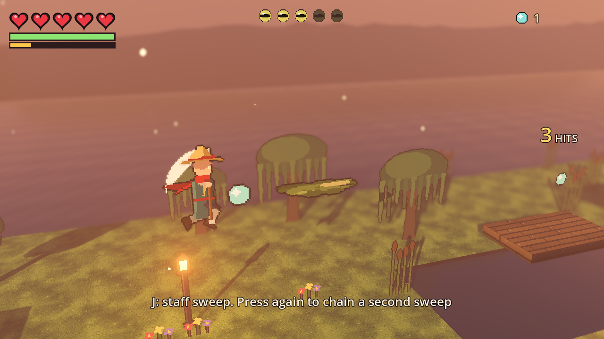
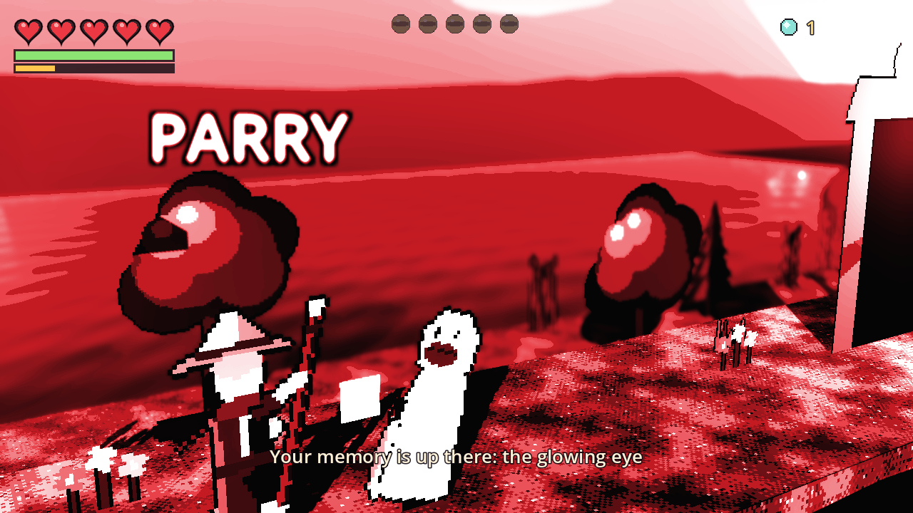
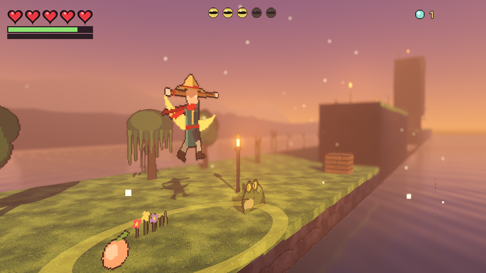

# BREKEKEKEX — The Hunter Who Forgot

An HD-2D swamp action-platformer made in **Godot 4.7** for Assignment 6 (Computer Graphics & Gaming).
Pixel-art characters stand in a real 3D diorama: shadows, lantern light in volumetric fog, reflective water,
depth of field, and a dynamic camera that swings in for close-up fights.



| Juggle | Parry impact frame | Moon Breaker |
|---|---|---|
|  |  |  |

## Play it

| How | What to do |
|---|---|
| Easiest | Double-click **`Play Game.command`** |
| In the editor | Double-click **`Open in Godot.command`**, then press **F5** (or the ▶ button, top right) |
| Terminal | `godot --path . --rendering-driver vulkan` |

> On this Mac, Godot's default Metal renderer freezes ("timeout waiting for fence"). The project is set to use
> **Vulkan** (`project.godot` → `rendering_device/driver.macos`), and the launchers force it too.

## Controls

| Action | Keyboard | Gamepad |
|---|---|---|
| Move | A / D or ← / → | Left stick |
| Jump (hold = higher) / wall-jump | Space | A |
| Drop through wooden platform | S + Space | Down + A |
| Staff sweep (chain 2) | J | X |
| Launcher (then Space to follow) | W + J | Up + X |
| Air combo / Dive | J in air / S + J or L in air | X / Down + X |
| Staff SMASH (stamina) | L | Y |
| Block (hold) / **Parry** (tap just before a hit) | K | RB |
| Dodge roll / **Perfect dodge** (just as a hit lands) | Shift | B |
| **Moon Breaker** (full spirit meter) | U | R3 |
| Staff Vault / Air Dash (memory powers) | Space / Shift in mid-air | A / B |
| Talk | E | LB |
| Pause | Esc / P | Start |

## The story

Iko, a frog hunter, wakes in the reeds with no memory. Old Koax, a hermit, tells him the frog cult of the
**Toad King** seals stolen memories inside frog eyes. Five lands, five eyes. Each one gives back a piece of his
past (his village, his sister Mira, the night of the raid, the ritual). Then he faces the Toad King on his throne.
He remembers everything, but something vast opens its eyes beneath the marsh. *To be continued.*

## Features (Assignment 6 checklist)

- Engine: Godot 4.7, Forward+ renderer, GDScript, scene-based architecture
- Start screen, pause menu, game over, level complete, ending + sequel tease
- 5 levels (Swordigo-style): islands over water, crate puzzle, wall-jump shafts, one-way platforms, thorns, keys & gates
- Player: run/jump with coyote time and jump buffering, variable jump height, wall slide/jump
- BREKEKEKEX-style combat: horizontal sweeps vs vertical strikes, **launcher → air juggles → dive**, **parry**,
  **perfect dodge** (slow motion), spirit meter + **Moon Breaker** special, powers unlocked by memories
  (Staff Vault double jump, Air Dash, Spirit Wave, Koax's Blessing)
- Enemies that are hard to read: randomised tells, **feints**, **dodging your swings**, combos, pounces, charges,
  thrown daggers (knock them back), attack slots so groups surround you; Toad King boss with an enraged **phase 2**
- Anime presentation: **impact frames**, hit-stop, slow-motion kill cam, combo counter, popups, shockwave rings
- Collectibles: spirit orbs, peaches (heal), keys, memory eyes; shrines = checkpoints that **save to disk**
- Side character (Old Koax) tells the story with typewriter dialogue
- Physics: CharacterBody3D movement, RigidBody3D crates, Area3D triggers, collision layers
- Audio: 27 sound effects + 4 music tracks, pooled players, cross-fading music
- Camera: delayed spring follow, look-ahead, air tilt, **arena framing** of hunter + opponent, over-the-shoulder swing,
  **event cameras** (low angle on launchers, high angle on dives, crane shot on the special…), FOV punch, shake, depth of field

## Project layout

```
game_play/
├── project.godot            engine settings, autoloads, layers, Vulkan driver
├── Play Game.command        double-click launcher
├── Open in Godot.command    opens the editor
├── assets/
│   ├── sprites/             hunter / enemy sprite sheets (PNG + JSON), props/
│   ├── textures/            64×64 tiling ground textures
│   ├── audio/               .wav sound effects and music
│   ├── levels/              level_1.txt … level_5.txt  (text tile maps)
│   └── dialogue/story.json  all story text, hints, level names
├── scenes/
│   ├── actors/              player, hopper, brute, cultist, boss
│   ├── world/               game, pickup, gate, shrine, exit, crate, thorns, npc, level_preview
│   └── ui/title.tscn        start screen
├── scripts/
│   ├── autoload/            Controls (input map), GameState (save/progress), Audio
│   ├── actors/              player, enemy base + enemy types, sheet_sprite
│   ├── world/               level builder, level data, themes, props, water shader, world objects
│   ├── camera/camera_rig.gd dynamic camera
│   ├── fx/hit_fx.gd         particles
│   ├── ui/                  HUD, dialogue, menus, title, shared style
│   └── game/game.gd         runs a level
├── tools/
│   ├── assetgen.cpp         draws every sprite & texture with our own rasterizer (scan-line fill, matrices)
│   ├── audiogen.py          synthesises every sound
│   └── autotest.gd/.tscn    developer test bot (screenshots, wall-jump/crate/platform checks)
└── docs/                    DESIGN.md, LEVELS.md, ASSIGNMENT6_GUIDE.md, screenshots/
```

## Rebuilding the assets (optional)

```bash
c++ -O2 -std=c++17 tools/assetgen.cpp -o tools/assetgen && ./tools/assetgen
python3 tools/audiogen.py
```

## Docs

- [docs/HOW_IT_WORKS.md](docs/HOW_IT_WORKS.md): **every system explained** (sprites, levels, rendering, combat, AI, camera…) + viva question bank
- [docs/ASSIGNMENT6_GUIDE.md](docs/ASSIGNMENT6_GUIDE.md): the Godot workflow in assignment order (viva prep)
- [docs/DESIGN.md](docs/DESIGN.md): architecture, camera, combat, rendering
- [docs/LEVELS.md](docs/LEVELS.md): how to edit or add levels
